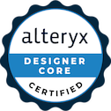

# Hey, I'm Rahim 👋

### Data Analytics Consultant at The Information Lab 📊
*Building dashboards people actually want to use*

I started out in the lab and ended up in the data. With an MSc in Applied Bioinformatics, I spent my early work analysing RNA-seq and clinical data and building pipelines in R and Python. Now I bring that same analytical thinking to business problems, building client dashboards and analytics solutions with Tableau, Alteryx, SQL and Snowflake.

**What I do**
- 🔍 **Investigate**: Dig into messy, complex datasets to find what matters
- 📈 **Visualise**: Build clear, interactive dashboards in Tableau
- 🧪 **Model**: Apply statistics to real-world data
- 🗄️ **Engineer**: Design databases and data workflows with SQL and Alteryx

## 🛠️ My Toolkit

## 🏅 Certifications

  

## ⭐ Featured work

**📊 Data Visualisation Projects**
- **[Anxiety: A Global Perspective](https://public.tableau.com/views/AnxietyAGlobalPerspective_17934652224970/AnxietyAnalysis?:language=en-GB&:sid=&:redirect=auth&:display_count=n&:origin=viz_share_link)**:

Tableau dashboard styled as a medicine box, exploring worldwide anxiety prevalence using IHME Global Burden of Disease data

**🧬 Research Projects** 
- **[Tissue-Specific Regulation of Mitochondrial Protein Import](https://github.com/samafs24/mitoiso-rnaseq)**:

HPC pipelines (R, Python, Bash, Nextflow) analysing transcript isoform usage across GTEx short-read and Nanopore long-read RNA-seq, with ClinVar/GWAS variant integration and Machine Learning prediction of mitochondrial targeting sequences
- **[Deep Learning for Retinal Disease Classification](https://github.com/samafs24/CNN_ML_Project)**:

Deep learning model built in Python (TensorFlow/Keras) to automatically classify retinal images into multiple disease categories. It uses transfer learning on a ResNet50 backbone, CLAHE contrast enhancement and ESRGAN super-resolution improve image quality, while ADASYN oversampling and class weighting stop the model from favouring the most common diseases.

- **[Mouse Phenotype Explorer](https://github.com/samafs24/impc-phenotype-database)**:

Developed a MySQL database of 50,000+ phenotype records, fed by reproducible R pipelines for data cleaning, integration and quality control. An interactive RShiny dashboard (Plotly, DBI) allows dynamic exploration of genotype–phenotype relationships, while PCA, UMAP and clustering identify gene groups with shared phenotypes

## 📫 Find me
[LinkedIn](https://www.linkedin.com/in/rahimafsana17)· [Tableau Public](https://public.tableau.com/app/profile/rahim.afsana/vizzes) · [DS Blogs](https://www.thedataschool.co.uk/blog/rahim-afsana/)

